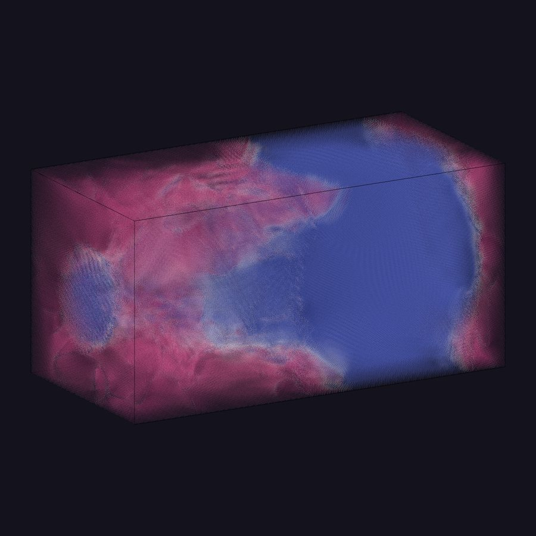
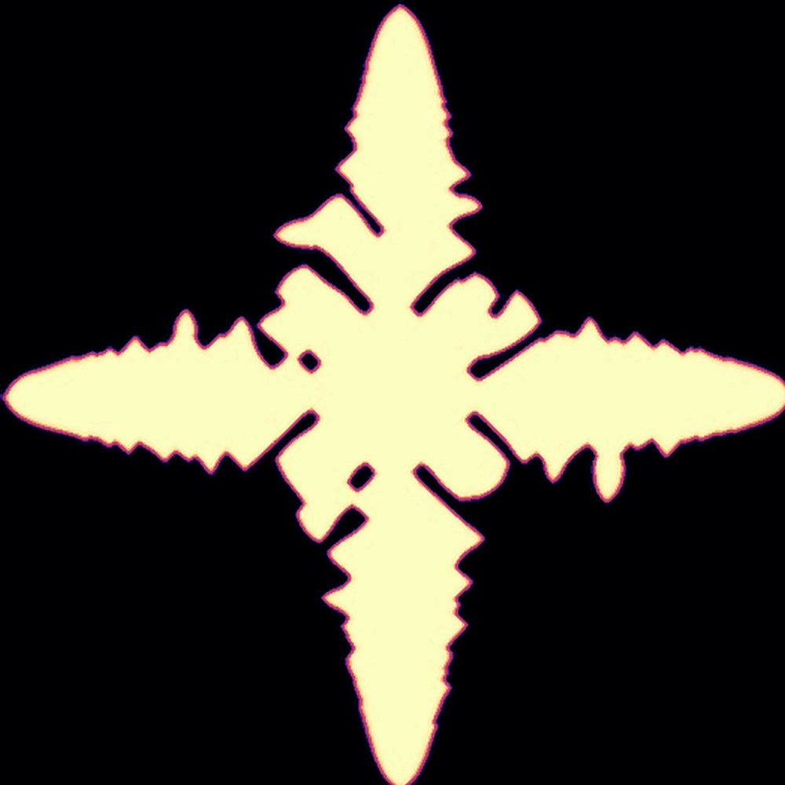

<section class="hero-band">
  

    
    
  

  

    

      
Computational physics · Data science · Montréal

      <h1 class="home-name">Ravneet Kaur</h1>
      
I build physics models of how materials form, from atoms to crystals, and turn the data they produce into answers people can use.

      

        <a class="btn-solid" href="/projects/">See my projects</a>
        <a class="btn-line" href="/assets/pdf/Ravneet_Kaur_Resume.pdf">Résumé</a>
      

    

    
Fig. 1 An alloy crystal growing in my phase field simulation, coloured by solute concentration.

  

</section>

<section class="models">
  
Selected models

  

    <figure><figcaption><b>Al–Si alloy, atom by atom</b>Phase field crystal, 3D, laser-printing conditions</figcaption></figure>
    <figure><figcaption><b>Alloy dendrite</b>Phase field, solid–liquid order parameter</figcaption></figure>
    <figure><figcaption><b>Pure-material crystal</b>Phase field, temperature field</figcaption></figure>
    <figure><figcaption><b>Frost on concrete</b>My photograph: the same physics, outside my door</figcaption></figure>
  

</section>

  
<strong>2048×1024×1024</strong>simulation grid

  
<strong>100 TB+</strong>output analysed

  
<strong>1,500+</strong>cores, scaling tests

  
<strong>3.9 / 4.0</strong>M.Sc. GPA, McGill

<i></i><i></i><i></i><i></i><i></i><i></i><i></i><i></i><i></i><i></i><i></i><i></i><i></i><i></i><i></i><i></i><i></i><i></i><i></i><i></i><i></i><i></i><i></i><i class="misfit"></i><i></i><i></i><i></i><i></i><i></i><i></i><i></i><i></i><i></i><i></i><i></i><i></i><i></i><i></i><i></i><i></i>

<section class="home-about">
  

    <h2>About</h2>
    
For my M.Sc. at McGill University, in Professor Nikolas Provatas's group, I modelled how aluminium–silicon alloys form their microstructure during laser powder bed fusion, the process behind metal 3D printing.

    
I extended the open-source OpenPFC framework from pure materials to binary alloys in C++/MPI, ran 3D simulations on Canada's national supercomputers, and wrote the pipeline that turned <strong>100 TB+</strong> of output into precipitate and dislocation statistics. The project was a Mitacs Accelerate collaboration with Hydro-Québec and experimental teams at the University of New Brunswick and McMaster University.

    
The same skills carry straight into industry: fast numerical code, analysis pipelines that hold up, and the habit of checking whether a result is physically and statistically believable before trusting it.

  

  <figure class="home-portrait">
    
    <figcaption>McGill convocation, October 2026</figcaption>
  </figure>
</section>

### Hire me

I'm looking for **Data Science, Scientific Computing and R&D roles**, in Montréal or remote across Canada. I'm strongest where real-world systems are messy and careful modelling matters: energy, materials, manufacturing and simulation.

- **Data & ML:** Python, pandas, NumPy, scikit-learn, LightGBM, SQL, DuckDB, time-series features, grouped cross-validation
- **Simulation & HPC:** C++, MPI, FFT/spectral methods, numerical PDEs, Slurm on Alliance Canada clusters
- **Shipping it:** Git, Streamlit, FastAPI, OVITO, Mathematica, clear writing for technical and non-technical audiences

### Highlights

- 2nd of 47, RQMP Grand Conference poster competition (2026)
- Prize, ORU IPL Analytics Hackathon (2026)
- Invited lightning talk, CHiMaD Phase Field Workshop XXI, Northwestern University (2026)
- M.Sc. GPA 3.9 / 4.0, McGill University · first in my family to earn a Master's degree
- Teaching Assistant, McGill Department of Physics, five terms (2024–2026)

### Beyond work

I'm a photographer at heart and was Creative Head of Sparks, my college physics society in Delhi, where I ran events and digital content. In Montréal I volunteer with Khalsa Aid Canada's food distribution.

