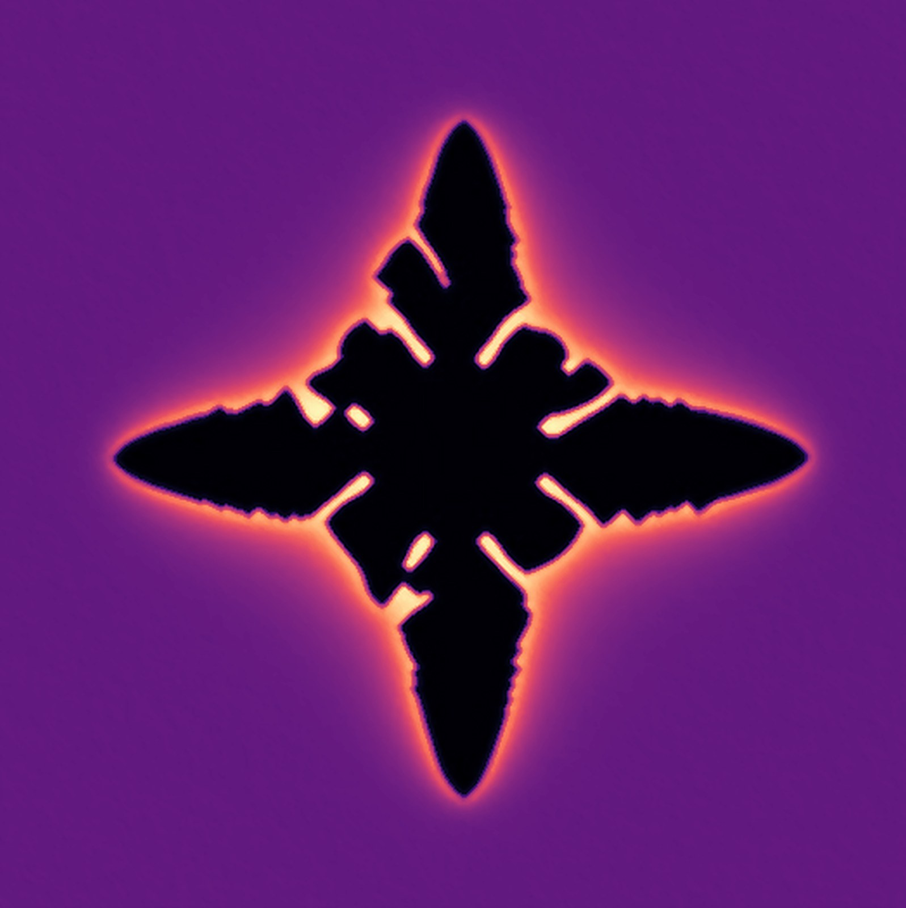
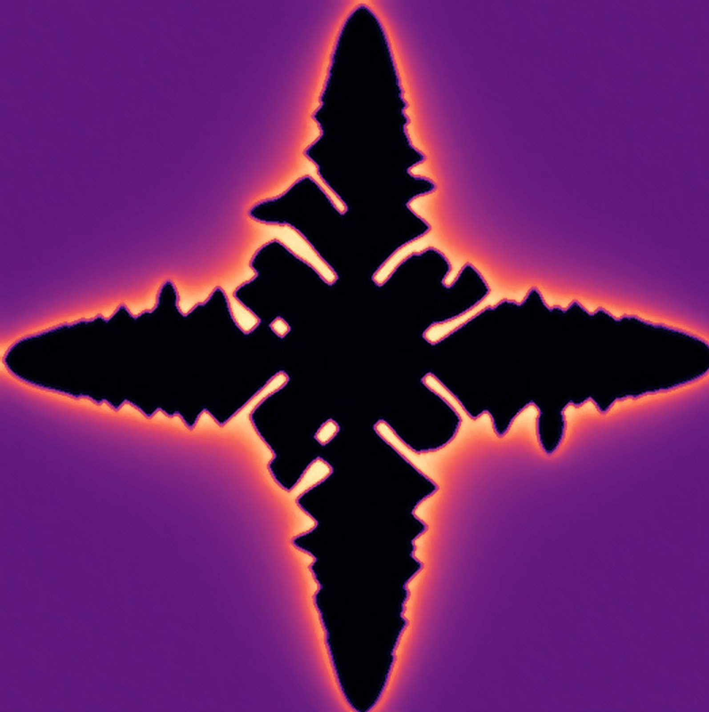
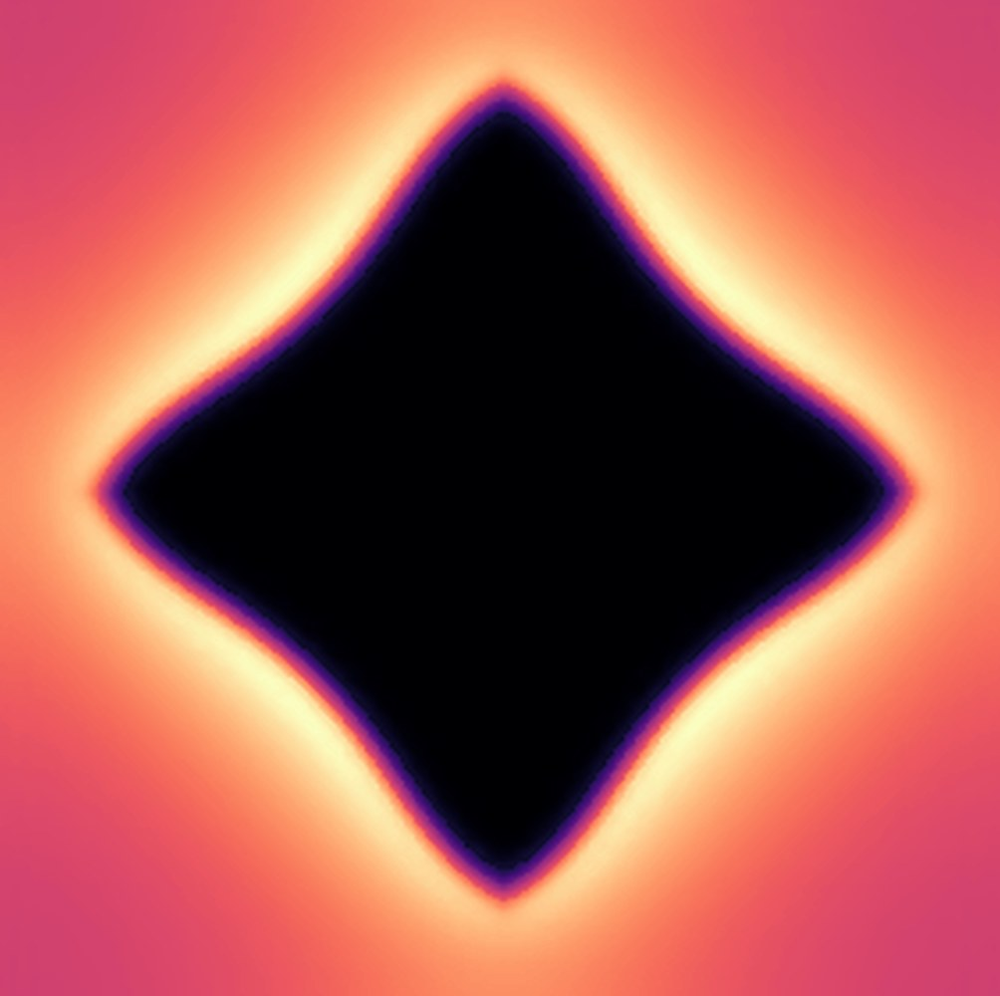
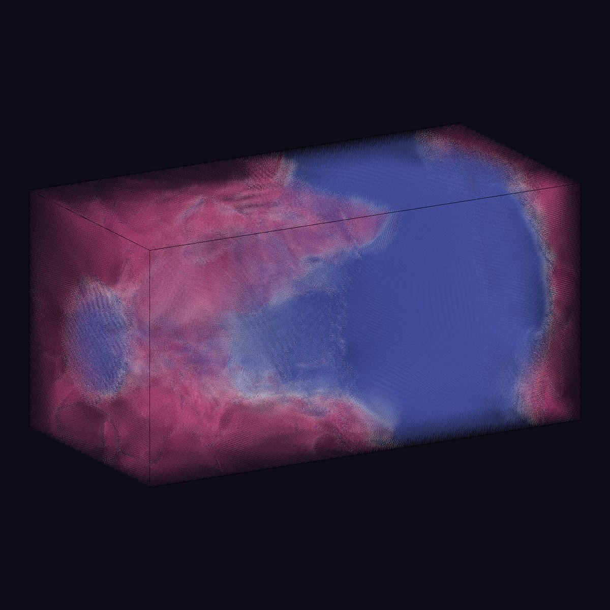
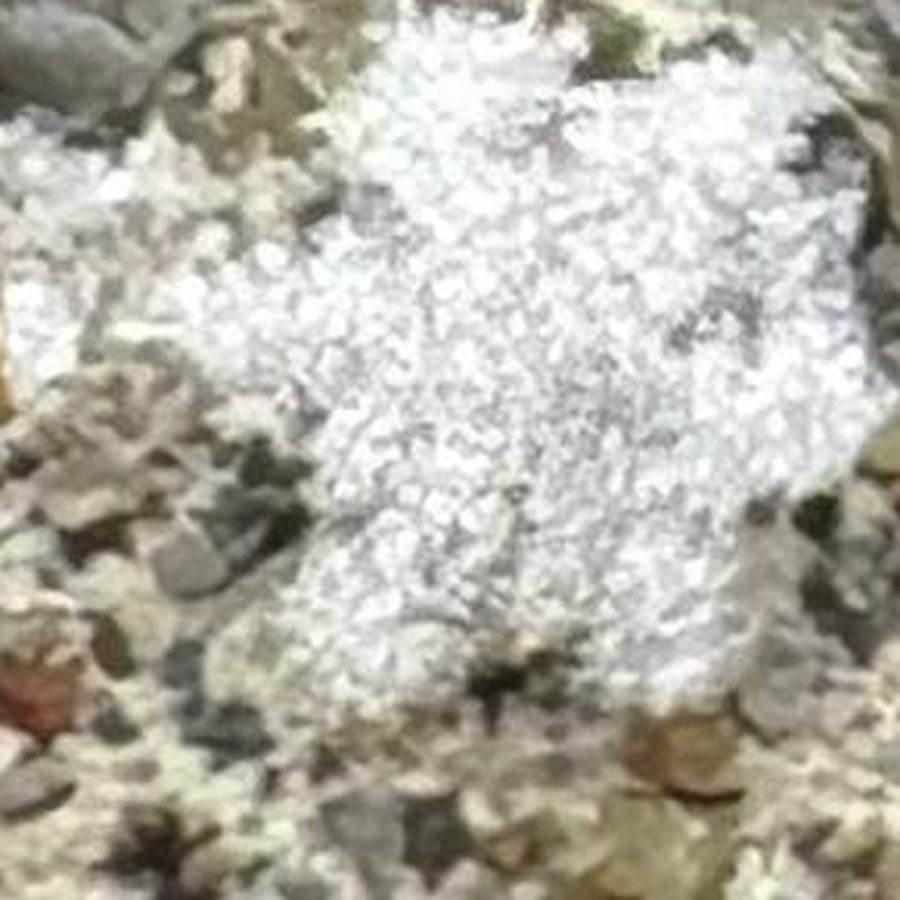
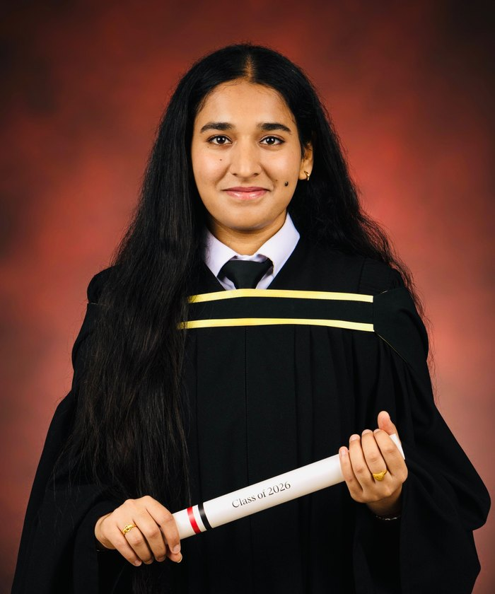
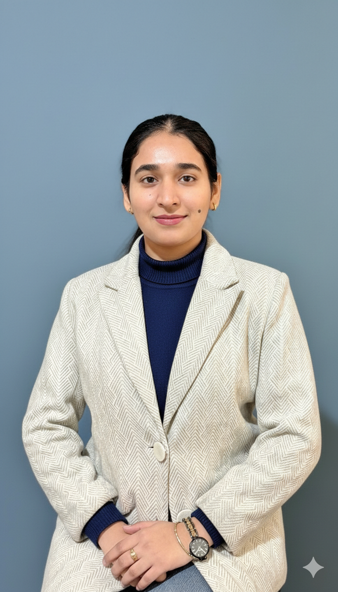

<section class="hero-band">
  

    
    
    
    
    
  

  

    

      <h1 class="home-name">Ravneet Kaur</h1>
      
      
Computational Materials Physics | Numerical Modelling &amp; Data Science

      
Master's in Physics

      
McGill University

    

    
Fig. 1 <em id="cap-t">An alloy crystal growing in my phase field simulation, coloured by solute concentration.</em>

  

</section>

<section class="home-about" id="about">
  

    <h2>About me</h2>
    
I'm Ravneet Kaur, a computational physicist based in Montréal. I recently completed my M.Sc. in Physics at McGill University in Professor Nikolas Provatas's group, where I studied how aluminium–silicon alloys form their microstructure during laser powder bed fusion, the process behind metal 3D printing.

    
For my thesis, I extended OpenPFC, an open-source phase field crystal framework, from pure materials to binary alloys in C++/MPI. I ran 3D simulations on grids of up to 2048 × 1024 × 1024 on the Digital Research Alliance of Canada's supercomputers, benchmarked the code's scaling to more than 1,500 cores, and built the Python pipeline that turned over 100 TB of output into statistics on precipitates and dislocations. The project was a Mitacs Accelerate collaboration with Hydro-Québec, carried out alongside experimental teams at the University of New Brunswick, so explaining simulation results to experimentalists and industry partners was part of the work. A first-author manuscript is in preparation.

    
I'm most interested in problems where physical modelling and data meet: building simulations, making sense of the large datasets they produce, and checking whether a result is physically and statistically believable before trusting it. I now bring the same approach to data science, from a win-probability model for the ORU IPL Analytics Hackathon, where I caught and fixed data leakage in my own validation, to an electricity-demand forecasting pipeline built on public grid and weather data.

    
Outside of research, I'm a photographer at heart. I love catching physics in everyday life; the frost photo on my home page is one example. I volunteer with Khalsa Aid Canada's food distribution in Montréal, and one day I'd like to learn to fly.

  

  <figure class="home-portrait">
    
  </figure>
</section>

<i></i><i></i><i></i><i></i><i></i><i></i><i></i><i></i><i></i><i></i><i></i><i></i><i></i><i></i><i></i><i></i><i></i><i></i><i></i><i></i><i></i><i></i><i></i><i class="misfit"></i><i></i><i></i><i></i><i></i><i></i><i></i><i></i><i></i><i></i><i></i><i></i><i></i><i></i><i></i><i></i><i></i>

<section class="cv-block">
  <h3>Education</h3>
  <ul class="cv-list">
    <li><b>McGill University</b> · M.Sc. in Physics, Computational Materials Physics2026</li>
    <li><b>SGTB Khalsa College, University of Delhi</b> · B.Sc. (Honours) in Physics2023</li>
  </ul>
</section>

<section class="cv-block">
  <h3>Awards &amp; Honours</h3>
  <ul class="cv-list">
    <li><b>2nd of 47</b> · RQMP Grand Conference poster competition2026</li>
    <li><b>Winner</b> · ORU IPL Analytics Hackathon2026</li>
    <li><b>Travel award</b> · CHiMaD Phase Field Methods Workshop XXI, Northwestern University2026</li>
    <li><b>Mitacs Accelerate Fellowship</b> · with Hydro-Québec2024–2026</li>
  </ul>
</section>

<section class="cv-block">
  <h3>Talks</h3>
  <ul class="cv-list">
    <li><b>Lightning talk</b> · CHiMaD Phase Field Methods Workshop XXI, Northwestern UniversityNov 2026</li>
    <li><b>Oral presentation</b> · RQMP Materials Engineering for New Technologies Axis Meeting, SherbrookeOct 2026</li>
    <li><b>Poster</b> · RQMP Grand Conference, 2nd prize2026</li>
  </ul>
</section>

<section class="cv-block">
  <h3>Teaching</h3>
  <ul class="cv-list">
    <li><b>Teaching Assistant</b> · Department of Physics, McGill University, introductory physics (five terms)2024–2026</li>
  </ul>
</section>

<section class="hire" id="hire-me">
  <h3>Hire me</h3>
  
I'm looking for <b>Data Science, Scientific Computing and R&amp;D roles</b> in Montréal or remote across Canada, where careful modelling of messy, real-world systems matters: energy, materials, manufacturing and simulation.

  <ul class="hire-skills">
    <li><b>Data &amp; ML</b> Python, pandas, NumPy, scikit-learn, LightGBM, SQL, time-series forecasting</li>
    <li><b>Simulation &amp; HPC</b> C++, MPI, spectral methods, numerical PDEs, Slurm</li>
    <li><b>Tools</b> Git, Streamlit, FastAPI, OVITO, Mathematica</li>
  </ul>
  

    <a href="/assets/pdf/Ravneet_Kaur_Resume.pdf">Résumé (PDF)</a>
    <a href="https://www.linkedin.com/in/ravneet-kaur-bains">LinkedIn</a>
    <a href="https://github.com/RAVNEETKAUR15">GitHub</a>
  

  
ravneetkaur24191508@gmail.com

</section>

