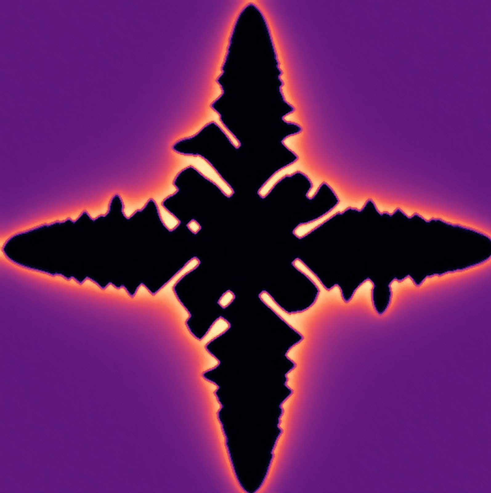

<section class="page-band">
  

    
  

  

    <h1 class="page-band__title">Achievements</h1>
    
Awards, funding and recognition. Click any certificate to see it full size.

  

</section>

  <figure class="award">
    
    <figcaption>
      <b>2nd of 47, poster competition</b>
      RQMP Grand Conference · 2026
    </figcaption>
  </figure>

  <figure class="award">
    
    <figcaption>
      <b>Winner</b>
      ORU IPL Analytics Hackathon · 2026
    </figcaption>
  </figure>

  <figure class="award">
    
    <figcaption>
      <b>Full travel funding and lightning talk</b>
      CHiMaD Phase Field Methods Workshop XXI, Northwestern University · 2026
    </figcaption>
  </figure>

  <figure class="award">
    
    <figcaption>
      <b>Certificate of Academic Achievement</b>
      2nd in college, B.Sc. (Honours) Physics, SGTB Khalsa College · 2021–22
    </figcaption>
  </figure>

  <figure class="award">
    
    <figcaption>
      <b>Creative Team Member</b>
      SPARKS, the Physics Society, SGTB Khalsa College · 2021–22
    </figcaption>
  </figure>

